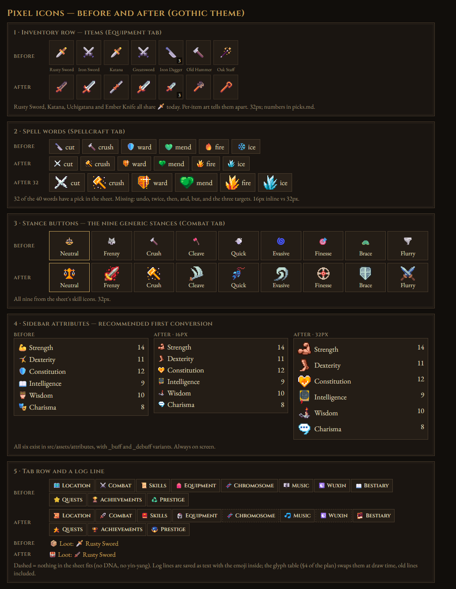
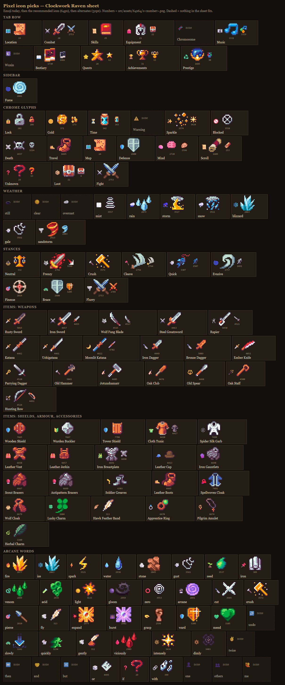

# Pixel icons

Plan only. No code yet. Story 1 waits on one decision: §7.1.

- **What:** 1,142 `icon:` fields in `src/core/data` and about 750 emoji hard-coded
  in `src/ui` and `src/core` → pixel sprites.
- **How:** one `<Icon>` component. Per-entry `art` file → emoji-keyed glyph table →
  the emoji, as today. Registries switch one at a time.
- **Art on hand:** about 250 committed icon files, all drawn on a 32px grid; no code
  uses any of them today. The full Clockwork Raven sheet, 8,256 icons, is in
  `src/assets/64x64/` in the main checkout (not in git). It has a pick for 111 of the
  125 tier 1–3 concepts checked so far ([pixel-icons/picks.md](pixel-icons/picks.md)).
- **License:** the 32px set is Clockwork Raven, bought (user, 2026-10-20). Allowed in
  the game and in this private repo; not in a public one. 41 committed files in
  `combatStyleIcons/` are Ækashics icon sheets.
- **First conversion:** attributes, resources and superattributes in the sidebar.
  14 entries, 13 already have art, on screen all the time.



The image is a screenshot of [pixel-icons/mockup.html](pixel-icons/mockup.html):
hand-placed sprites from the Clockwork Raven sheet on the gothic tokens. Open the
HTML from the main checkout, which has `src/assets/64x64/`. Dashed = nothing in the
sheet fits.

## 1. Census

### 1.1 `icon:` fields by registry

Counted on 2026-10-20 by loading every `src/core/data/*.data.ts` module through
vite-node and walking its exports (throwaway script, not committed). Generated
entries are counted where the registry holds them. `src/core/data/shelved/` (160
more) is out of play and left out.

| Registry | File | Fields | Distinct emoji (per registry) | Note |
|---|---|---:|---:|---|
| MATERIALS | materials | 177 | 115 | About 90 are generated at load from mutagen data (genes, mutagens, nucleases); 🧬 ×12 |
| SKILLS | skills, wordskills | 94 | 72 | 40 are word skills that copy their arcane word's icon |
| SPOTS | locations | 77 | 60 | |
| SPOTS activities | locations | 64 | 42 | ⚔️ ×7, 🔍 ×5 |
| STATUSES | statuses | 70 | 53 | |
| MONSTERS | monsters | 59 | 46 | 39 already have an Ækashics portrait through `art` |
| MUTATIONS | mutagens | 52 | 42 | |
| MAIN_GENES + their abilities | mutagens | 30 + 26 | 28 + 15 | |
| MONSTER_TAGS | bestiary | 49 | 49 | |
| DEITY_TAGS | deities | 43 | 41 | |
| ARCANE_WORDS | spellcraft | 40 | 39 | |
| ITEMS | items | 39 | 30 | 🗡️ on four different blades |
| TECHNIQUES | martial | 25 | 25 | |
| MIRACLES | spellcraft | 24 | 16 | 📦 ×8 as a placeholder; a further 24 copies sit in `MIRACLES.*.spec` |
| DISCIPLINES outcomes | disciplines | 24 | 18 | |
| STYLES (stances) | styles | 21 | 21 | 9 generic stances, 12 schools |
| REAGENTS | alchemy | 15 | 15 | |
| MUSIC_ARCHETYPES | music | 13 | 13 | |
| NPCS | npcs | 12 | 12 | |
| WEAPON_FAMILIES | martial | 11 | 11 | |
| RUNES | runes | 11 | 11 | |
| ACHIEVEMENTS | achievements | 10 | 10 | |
| PRESTIGE_BOONS | prestige | 10 | 10 | |
| TITLES | titles | 9 | 9 | |
| DEITIES | deities | 8 | 7 | `art` field exists; no portraits yet |
| DISCIPLINES | disciplines | 8 | 8 | |
| FORK_ARCHETYPES | martial | 8 | 7 | |
| BESTIARY_FACTS | bestiary | 8 | 8 | |
| PSI_AXES, PSI_QUANTITIES, PSI_RECOGNITIONS | spellcraft | 8 + 8 + 7 | 8 + 8 + 7 | |
| BREW_FORMS, BREW_FORMULAS | alchemy | 7 + 4 | 7 + 4 | |
| POSITIONS | martial | 7 | 7 | |
| ATTRIBUTE_LIST | attributes | 6 | 6 | |
| PRESTIGE_SOURCES | prestige | 6 | 6 | |
| RESOURCES | resources | 5 | 5 | |
| MUSIC_METERS | music | 4 | 4 | |
| RUNE_PATTERNS, NAMED_RUNES | runes | 4 + 4 | 4 + 4 | |
| KEY_ITEMS | keyitems | 3 | 3 | |
| PREPS | preps | 3 | 3 | |
| SUPERATTRS | superattrs | 3 | 3 | |
| NUCLEASES, TOWERS | mutagens, towers | 1 + 1 | 1 + 1 | |
| **Total** | | **1,142** | **321** | 1,118 in the rows above plus the 24 `MIRACLES.*.spec` copies. Distinct counted across all registries, variation selectors ignored |

### 1.2 Emoji hard-coded outside the data

| Where | Occurrences | Distinct | What they are |
|---|---:|---:|---|
| `src/ui` (37 files) | 480 | 155 | Tab names, lock badges, prices, buttons, fallbacks such as `def?.icon ?? '📦'` |
| `src/core/text` | 112 | 60 | Log and message templates: `'📦 Loot: {icon} {item}'` |
| `src/core/systems` | 160 | 75 | Feed lines built in code, weather icons |

Most used in code: ⚠️ 41 (many in comments), ⚔️ 35, 🔒 35, 🪙 26, ⚡ 18, 📦 17, 🛡️ 15, 🧬 14, 🧠 14, 📜 13, ❓ 13, ✨ 13.
Typographic marks (✕ ✓ ★ ✦ ♯ ♭ ♩, arrows) are left out: they are font glyphs and
stay text in any theme.

### 1.3 How many drawings

- Data uses 321 distinct emoji; code uses 173; 120 are shared. **374 drawings would
  replace every emoji in the game** at the glyph level.
- The most-used emoji cover most fields: top 25 → 32% of the non-blank fields, top
  50 → 48%, top 100 → 66%, top 200 → 88%.
- One element set recurs everywhere: 🔥 ❄️ ⚡ 💧 🪨 💨 🌱 ☀️ 🌑 🔮 🧪 🐍 appear in
  arcane words, resistance skills, statuses, runes, reagents and genes. About 14
  sprites fill roughly 120 fields.

## 2. Where each kind is drawn

Three shapes of render site:

- **Markup:** `{def.icon}` in a Svelte template. Swap for a component.
- **String:** `${def.icon} ${def.name}` built into a tooltip line, a `title=`, or a log
  message. Needs text rendering that recognises emoji (§4.2 `GlyphText`).
- **SVG text:** map pins and the psionic chart draw the emoji as `<text>`. Needs
  `<image>`.

Line numbers as of 2026-10-20.

| Kind | Main sites | Size today |
|---|---|---|
| Items | Inventory grid cell [EquipmentPanel.svelte](../../src/ui/panels/EquipmentPanel.svelte) :650; item window :1124; tooltips :759; shop wares [LocationPanel.svelte](../../src/ui/panels/LocationPanel.svelte) :376 | 24px in the grid |
| Empty equipment slots | `SLOT_ICONS` [EquipmentPanel.svelte](../../src/ui/panels/EquipmentPanel.svelte) :88, drawn at :825 | 24px |
| Materials | Material stacks EquipmentPanel :794, :1212; gather tooltip LocationPanel :179; bench ingredients in BenchPanel | 24px / inline |
| Spots | Spot header LocationPanel :253; map pins [MapCard.svelte](../../src/ui/MapCard.svelte) :355 (SVG); destination lists MapCard :400, :419, :454; battle header [BattleStage.svelte](../../src/ui/lib/BattleStage.svelte) :244 | heading / pin |
| Activities | Activity buttons LocationPanel :164; map card MapCard :519 | inline |
| Monsters | Battle sprite: portrait or emoji BattleStage :342 (body/badge logic :216–227); combat list [CombatPanel.svelte](../../src/ui/panels/CombatPanel.svelte) :429; DareModal; BestiaryPanel | sprite / inline |
| Stances | Stance button [CombatPanel.svelte](../../src/ui/panels/CombatPanel.svelte) :420; "You" line BattleStage :261 | 17px |
| Techniques, positions | CombatPanel :476, :484, :646–672; MartialPlanner | inline |
| Statuses | Sidebar afflictions; CombatPanel :453; BattleStage status row :315 | inline |
| Arcane words | Lexicon pill [SpellcraftPanel.svelte](../../src/ui/panels/SpellcraftPanel.svelte) :547; sentence strip :494; tooltip :561 | inline |
| Miracles, deities, deity tags | SpellcraftPanel :641–732 | inline / glyph |
| Psionics | SpellcraftPanel :802 (SVG `<tspan>`), :814–860 | inline |
| Skills | SkillsPanel; ability strip CombatPanel :166 | inline |
| Attributes, superattributes | Sidebar rows [Sidebar.svelte](../../src/ui/panels/Sidebar.svelte) :412, :424; attribute tooltips :167, :261 | inline |
| Resources | Sidebar bars print text labels (HP, Stamina, Mana); the icons appear in tooltips and log lines | inline |
| Titles | Worn title Sidebar :268 | inline |
| Alchemy, disciplines, preps, mutagens | BenchPanel, ChromosomePanel, flask EquipmentPanel :1009 | inline |
| Runes | EquipmentPanel :611, :679, :1099 | inline |
| Music | MusicPanel | inline |
| NPCs, key items, quests, achievements, prestige | LocationPanel :317, KeyItems, own panels | inline |
| Tab row | [App.svelte](../../src/ui/App.svelte) :103–115 | in the tab label |
| Top bar | Pause, time sense, weather `WEATHER_ICONS` App.svelte:283–300 | inline |
| Log | [LogFeed.svelte](../../src/ui/LogFeed.svelte) :27 prints `entry.msg`. The message is a **string stored in the save** (`LogEntry.msg`) with the emoji already inside, from 53 `{icon}` slots in `log.text.ts` and feed lines built in code (24 in combat.ts alone) | inline |

## 3. Pixel art already in the repo

None of the folders below is referenced by any code in `src/`, `forge/` or `tests/`
today, so they can be moved or ignored without breaking anything.

Every committed icon is on a **32px grid**: the 64×64 files are 32px art drawn at
double size (checked by testing for uniform 2×2 blocks), and the Ækashics sheets are
32px icons at ×1. One grid for everything: draw at 32px (×1) or 64px (×2).
16px halves the art — sharp on a 2× screen, loses pixels on a 1× screen. 24px and
48px are not clean multiples.

| Folder | Files | What it shows | Fits | Source |
|---|---:|---|---|---|
| `attributes/` | 63 | 21 stats, each plain / `_buff` / `_debuff`: strength, dexterity, constitution, intelligence, wisdom, charisma, hp, mana, stamina, focus, soul, dominion, martial, endurance, luck, fate, crit, attack, DR, speed, 3 regeneration | ATTRIBUTE_LIST 6/6, RESOURCES 5/5 (spirit → soul), SUPERATTRS 2/3 (no Force), stat lines in tooltips | Clockwork Raven (file names are the user's renames) |
| `system/` | 41 | 20 actions, plain / `_disabled` / `_full`: achievement, ascension, combat, craft, disassemble, equipment, exit, fish, harvest, help, inventory, load, mine, rank, researchStage, rest, save, settings, skills, town, travel | Tab row 8/11; activities (mine, fish, harvest, rest); 📦 → inventory chest; ❓ → help | Clockwork Raven |
| `equipment_slot_placeholders/` | 20 | Empty-slot silhouettes: head, chest, hands, legs, feet, shoulders, neck, ring1, ring2, mainHand, offHand, artifact, emblem, eyes, relic, trinket, tool1–4 | Empty slots 9/13; stand-ins for plain armour | Clockwork Raven |
| `weapons/` | 14 | shortsword, longsword, greatsword, colossalSword, katana, dagger, axe, hatchet, battleaxe, greataxe, hammer, greathammer, staff, advancedStaff | Superseded by the full sheet. The file names do not match the art: `longsword.png` is a katar (c4453) | Clockwork Raven |
| `weapons/whips/` | 27 | Whips. The game has no whip | — | Clockwork Raven. File names `c4507`…`c5394` are cell numbers from a sheet of 5,000+ icons |
| `books/` | 16 | 12 books, 4 scrolls (`c1681`–`c1684`) | Key items (daybook, stamp), Bestiary tab, 📖 📜 📕 | Clockwork Raven, same sheet |
| `keys/` | 10 | Keys | Office key, 🗝️ | Clockwork Raven, same sheet |
| `runes/` | 11 | Grey rune stones with Elder Futhark marks, one broken | RUNES 11/11 by count; all the same grey, so tint per rune or redraw | Clockwork Raven |
| `combatStyleIcons/` | 48 | 41 Ækashics sheets: 39 of nine 32px icons (slashes, claws, beams, gear) and 2 odd sizes. 7 single 64×64 swords and marks (`c2754`…`c3259`) | Stances, techniques, statuses, monster abilities | **41 Ækashics:** the sheet names match battlers in `src/assets/enemies/` one for one (Scarlet King, Void Goddess, Sea Goddess, Tomb Reaper, Cosmos Xoer, Slime Dragon, …). **7 Clockwork Raven:** same `c…` numbering and 64×64 format as the sheet above |
| `tilemaps/` (gitignored) | ~10,600 props | Epic RPG World props: barrels, crates, bones, rocks, webs, vases, blacksmith props, wells, ladders | Spot icons, some materials | Rafael Matos, bought; no redistribution (AUTHORSHIP §9) |
| `enemies/` (gitignored) | 2,169 | Battlers | Already used through `MonsterDef.art` | Ækashics |
| `deities/` | 0 | README only | `DeityDef.art` exists, nothing drawn | — |
| `64x64/` (main checkout, untracked, not ignored) | 8,256 | The full Clockwork Raven sheet, `c1.png`…`c8256.png`, 29 MB. Index in §3.2 | Most of tiers 1–3; picks in [pixel-icons/picks.md](pixel-icons/picks.md) | Clockwork Raven; added by the user 2026-10-20 |
| `react.svg` | 1 | Vite template leftover | — | Unused |

### 3.1 License findings

1. **41 files in `combatStyleIcons/` are Ækashics content and are in git history**
   (since the import commit `e2599ac`, 2026-08-24). The terms forbid redistribution,
   the same as the battlers. AUTHORSHIP §9 said making the repo public is "a settings
   toggle" because no Ækashics file was ever committed; these files make that untrue.
   The repo is private (checked 2026-10-20), so nothing has been published. Options,
   the user's call and outside this plan's code: (a) `git rm --cached`, add to
   `.gitignore`, and rewrite history with `git filter-repo` before any public flip;
   (b) ask Ækashics, as §9 already suggests. Until then this plan uses none of them.
2. **Everything else committed is Clockwork Raven** (clockworkraven.itch.io), bought.
   The user confirmed it on 2026-10-20 and supplied *Clockwork Raven General Licence
   v1.2*. A pixel comparison against the full sheet the same day: 185 of the 209
   files are identical to a sheet cell (`longsword.png` = c4453, `travel.png` = c24,
   `ascension.png` = c1685, …). The other 24, mostly attribute buff/debuff variants,
   match no cell exactly: edited versions, which the licence covers. What it allows
   here:

   | Question | Licence | Here |
   |---|---|---|
   | Use in a commercial game | Yes (§3a) | Fine |
   | Raw files in this private repo | Not "distributed as a separate product"; the licence lets a team working on the project share them (§3b) | Fine |
   | Raw files in a public repo | Would be distributing the assets as they are (§3a, §3b) | Not allowed. Same scrub as point 1 before any public flip |
   | Crops, tints, recolours | Allowed; the edited file stays under the licence (§3c) | Rune tints are fine; edited files are no freer than the originals |
   | Screenshots | Allowed when tied to the project (FAQ a) | The mockup PNG is fine |
   | Credit | Optional; suggested "Clockwork Raven – Additional Art Assets" (§3d, FAQ e) | Add to the credits when the game ships; never claim the art as ours |
   | Mods | Only free mods that tell users the assets cannot be reused (FAQ h); no engine or template that hands the files on (§3b, FAQ b) | Same flag as Ækashics if a modding SDK is ever planned |
   | AI | Must not be used to train any machine, AI or software that makes derivative or similar work (§3f, FAQ g) | Missing icons in this style are drawn by a person or bought, never generated from these files |

3. **Epic RPG World props** can be used for icons only from a gitignored folder. A
   cropped prop is an edited version and still may not be redistributed.

### 3.2 Where things are in the full sheet

The file number is the cell's position in the sheet, which is laid out by theme.
Weapons and armour repeat each item across rows of 80, one row per colour.

| Numbers | Contents |
|---|---|
| 1–60 | UI and system icons: save, load, settings, help, trophy, star, chest, map, book, helmet, sword; white silhouettes |
| 61–160 | Map and place icons: houses, tents, castles, gates, towers, mountains, trees, waterfall, chapel, statues, wells; NPC and monster heads; an inn sign |
| 161–400 | Bags, jars, goblets, keys (215–224), torches, lanterns, books, scrolls, sacks, chests and padlocks (273–288), flags, thread, quills, scales (332), anvil (333), tombstone (338), hourglasses (342–343), bowls, coins (369–372) |
| 401–480 | Gems, statues, skulls, keys, mushrooms |
| 481–960 | Ores, ingots, crystals, gems, in colour sets |
| 961–1480 | Monster parts: skulls, horns, claws, teeth, eggs, feathers, scales, hides; mushrooms and herbs |
| 1481–1680 | Potions and bottles |
| 1681–1760 | Books, scrolls, rune stones, orbs, wands |
| 1761–1880 | Modern objects (phones, tapes); not useful here |
| 1881–2000 | Fish, sea creatures, shells, fishing gear, webs |
| 2001–2440 | Food: fruit, vegetables, meat, bread, meals, drinks |
| 2441–2660 | Stat icons with buff and debuff marks (the source of `attributes/`) |
| 2661–2720 | Small status marks: sleep, poison, burn, stun |
| 2721–2840 | Combat skills: crossed swords, slashes, holy crosses, spears, crosshair (2814) |
| 2841–3040 | Elements: earth, ice, fire, water, wind, nature, blood, dark, in several shapes each |
| 3041–3360 | Effects: volleys, orbs, hearts, clovers, holy light, eyes, paws, skulls, shield buffs, speed up and down, gathering and crafting actions, music notes (3329–3331) |
| 3361–3600 | Effect sets per colour: crescents, sparkles, fire (3489–3500), ice and snow cloud (3505–3520), lightning and storm cloud (3521–3536), nature, wind, gold light, poison |
| 3601–4440 | Framed skill icons, one colour set per row |
| 4441–5480 | Weapons. Steel row 4449–4528, then gold 4529, blue 4609, purple 4689, teal 4769, red 4849, green 4929, dark 5009, bronze 5089 (same order within each row), then one-off weapons |
| 5481–7480 | Armour by colour: shields, chest pieces, helmets, hats, greaves, gloves, bracers, boots, rings, amulets, belts, capes, masks. Leather set 6657–6688, iron set 6689–6720 |
| 7481–7660 | Robes and clothes |
| 7661–7960 | Orbs, badges, shields, banners, crystals, arrows |
| 7961–8256 | Boots, gloves, rings and amulets by colour |

## 4. Mechanism

Precedent: `MonsterDef.art` + [enemyArt.ts](../../src/ui/lib/enemyArt.ts) and
`DeityDef.art` + [deityArt.ts](../../src/ui/lib/deityArt.ts). An optional filename on
the def, an `import.meta.glob` in `src/ui/lib`, and the emoji when the file is
absent. This plan extends that to every icon.

### 4.1 Resolution order

```
<Icon of={def} />   1. def.art               per-entry file; wins
                    2. GLYPH_ART[def.icon]   one table, emoji → file
                    3. def.icon              the emoji, as today
```

- **`art?: string`** on every def type that has `icon`. A path under
  `src/assets/icons/`. Defs are not saved, so no save change.
- **`GLYPH_ART`** in `src/ui/lib/glyphArt.ts`: `{ '🔒': 'chrome/lock.png', '🔥':
  'elements/fire.png', … }`. One entry fixes every def and every hard-coded string
  that uses that emoji.
- **Why both layers.** The glyph table is the cheap one: 100 drawings cover 66% of
  fields, and it is the only thing that can reach text already stored in a save. The
  per-entry `art` covers the cases where one emoji stands for several things: four
  blades on 🗡️, 📦 as a placeholder on 20 defs.

### 4.2 Files

| File | Job |
|---|---|
| `src/assets/icons/<source>/<group>/` | One folder per art source, then per group: `own/` (drawn for this game, always committed), `clockwork-raven/` (committed or gitignored, §7.1), `epic-rpg-world/` (props, gitignored like the tile packs). One source per folder means a history scrub is one `git filter-repo --path` per source. A missing folder means the emoji shows, as tile maps fall back to the node diagram |
| `src/assets/64x64/` | The full sheet, as a library to pick from. Never inside the `import.meta.glob`: Vite would copy all 8,256 files (29 MB) into every build, and a web build would serve the whole pack as loose files. Each picked icon is copied into `icons/clockwork-raven/<group>/` under a readable name (`iron_sword.png`); picks.md keeps the c-number. Kept out of git (§7.1) |
| `src/ui/lib/iconArt.ts` | One eager `import.meta.glob` over `src/assets/icons/**` (`?url`); `iconUrl(def)` and `glyphUrl(emoji)`. Core stays browser-free |
| `src/ui/lib/Icon.svelte` | `<Icon of={def} size={16 \| 32} />`. Draws `` with `image-rendering: pixelated` and `alt=""` (the name is printed beside it), else the emoji. Fixed box so rows do not shift |
| `src/ui/lib/GlyphText.svelte` | Draws a string, replacing each emoji that has a `GLYPH_ART` entry with an ``. Used by LogFeed, string-built tooltips and template messages. Old log lines in a save get art too, because the log stores text |
| SVG sites | MapCard pins and the psionic chart draw `<image href>` in place of `<text>` when a URL resolves |

`title=` and `aria-label` text stays as it is.

### 4.3 How a registry converts

One conversion = one registry's render sites switched from `{def.icon}` to
`<Icon of={def} />`, plus the art for that registry.

- **A group switches only when every entry in it has art** — all nine generic stances,
  all six attributes. A row that is half pixel, half emoji looks worse than either
  (mockup §2 and §3 show it).
- **The emoji stays in the data.** It is the fallback, the plain-text form for log
  templates and forge pickers, and what a fresh clone shows for licensed art. Never
  delete `icon`.
- **Both themes get the art.** No toggle. (A "keep emoji" switch in `theme.ts` is
  possible later if the default theme should keep them.)

### 4.4 Tests and the forge

- A content test: every declared `art` and every `GLYPH_ART` value resolves to a file
  under `src/assets/icons/`. Same shape as "declared bestiary art exists on disk"
  ([content.test.ts](../../tests/content.test.ts) :765). Paths under a gitignored
  source folder are exempt, since a clone may not have them.
- The forge edits `icon` as a plain string today. `art` starts as a plain text field;
  a picker that shows the folder's sprites comes later.

### 4.5 Sizes

| Site | Emoji today | Sprite |
|---|---|---|
| Inventory cell (56px tile) | 24px | 32px |
| Stance button | 17px | 32px (button grows about 15px; check the phone layout) |
| Inline text: sidebar rows, tooltips, log, word pills | about 15px | 16px (half the art; soft on a 1× screen) or 32px where the row can grow |
| Map pins | SVG text | SVG image at pin size |

The mockup shows the sidebar and the word pills at both 16px and 32px. 32px reads
better and makes the sidebar about half again as tall.

## 5. Coverage and what is missing

Ordered by how often the thing is on screen. Tiers are judged from the layout, not
measured.

- **Tier 1, every screen:** tab row, sidebar (attributes, resources, worn title,
  afflictions), top bar (pause, time, weather), log, and the chrome glyphs (🔒 lock,
  🪙 coin, ⏳, ❓, ⚠️, ⚔️).
- **Tier 2, the main loop:** Location (spot header, activities, map pins, NPCs),
  Combat (stances, monsters, statuses, techniques), inventory (items, materials,
  empty slots).
- **Tier 3, tabs opened on purpose:** skills, spellcraft, benches, runes.
- **Tier 4, rare:** bestiary tags, deity tags, music, achievements, titles, prestige,
  key items, towers.

"Picked" means a specific icon in the full sheet is chosen in
[pixel-icons/picks.md](pixel-icons/picks.md). "Not picked yet" means the sheet has a
matching block (§3.2) but nobody has chosen icons from it.

| Tier | Kind | Entries | Covered now | Missing — draw or buy |
|---|---|---:|---|---|
| 1 | Tab row | 11 | **9 picked** | Chromosome 🧬 (no DNA), Wuxin ☯️ (no yin-yang) |
| 1 | Attributes, resources, superattributes | 14 | **14**: the 13 committed files + Force c2881 | — |
| 1 | Chrome glyphs, top 15 | 15 | **14 picked** | ⚠️ warning |
| 1 | Weather | 10 | **7 picked** | still 🕳️, clear ☀️, overcast ☁️ (no plain sun or cloud) |
| 1 | Statuses | 70 | Not picked yet. Buff/debuff stat icons (2441–2660), status marks (2661–2720) and the element set cover most | Check in story 4 |
| 1 | Titles | 9 | Not picked yet | 9 |
| 2 | Spots, activities | 141 | Activities: mine, fish, harvest, rest, combat. Place icons 61–160 cover many spots; not picked yet | Epic RPG World props for the rest (gitignored folder) |
| 2 | Monsters | 59 | 39 Ækashics portraits (local only); monster heads 145–158 and monster parts for small icons | 20 without a portrait |
| 2 | Stances | 21 | **9 generic picked**; 12 schools not picked yet | — |
| 2 | Techniques, positions, fork archetypes | 40 | Not picked yet; skill icons 2721–2840, 3041–3360 | 40 to check |
| 2 | Items | 39 | **39 picked** | — |
| 2 | Materials | 177 | Not picked yet; ores, ingots, monster parts, herbs, food (481–1480, 2001–2440) | Gene family for the 🧬 materials |
| 2 | Empty equipment slots | 13 | 9 committed silhouettes | Extra hands (🤚 ×4): reuse `hands` or draw |
| 3 | Skills (authored) | 54 | About 8 obvious; gathering and crafting actions 3281–3345 add more | About 40 to check. The 40 word skills reuse the word art |
| 3 | Arcane words | 40 | **32 picked** | undo ↩️, twice ✌️, then ⏭️, and 🤝, but 🔀, one 👤, others 👥, me 🙋 |
| 3 | Miracles, deities, deity tags | 75 | Not picked yet; holy crosses, hearts, light (2791–2808, 3095–3168) | Pantheon-specific marks likely need drawing |
| 3 | Psionics | 23 | Not picked yet; eyes, orbs, waves (3065–3094, 3175) | Likely some |
| 3 | Alchemy | 26 | Not picked yet; potions and bottles (1481–1680), reagents in the material blocks | — |
| 3 | Disciplines, outcomes, preps | 35 | Not picked yet; food (2001–2440), cooking pots and tools (3317–3325) | — |
| 3 | Mutagens | 109 | Not picked yet | Gene and mutation marks likely need drawing; many share 🧬 |
| 3 | Runes | 19 | 11 committed grey stones; 21 rune stones in 1706–1726 | Tints per rune |
| 4 | Bestiary tags, facts | 57 | Not picked yet; monster parts, paws, eyes, skulls | Some |
| 4 | Music | 17 | Not picked yet; notes 3329–3331 | Most need drawing |
| 4 | Achievements, prestige, NPCs, key items, towers | 42 | Key items 3/3 (book, key, scroll); trophies, coins, NPC heads in 1–160 | Some |

### 5.1 Buy or draw

- **The purchased sheet comes first.** It is paid for and matches the committed set
  exactly. For the 125 concepts checked so far it has a pick for 111.
- **Missing so far (14):** Chromosome 🧬, Wuxin ☯️, warning ⚠️, still air 🕳️, clear
  sky ☀️, overcast ☁️, and the abstract words undo, twice, then, and, but, one,
  others, me. Expect more in mutagens, music and the pantheons when those are picked.
- **Buy or draw** the missing ones. A bought pack gets its terms checked the same way
  and its own folder under `src/assets/icons/`. Drawn icons go in `icons/own/`, drawn
  by a person or generated without Clockwork Raven files as input (their licence §3f
  forbids feeding them to any image generator). New art has to sit on the same 32px
  grid with the same dark outline to match.

## 6. Order of work

Each step is one story and one PR.

1. **Mechanism + sidebar.** `Icon.svelte`, `iconArt.ts`, `art` on the attribute,
   resource and superattribute defs; move `attributes/` to
   `icons/clockwork-raven/attributes/` and copy Force (c2881) beside them; switch the
   sidebar rows and attribute tooltips. 14 of 14 have art. Decide 16px vs 32px on the
   real sidebar in both themes. Waits on §7.1.
2. **Tab row + `GlyphText` in the log.** 9 tabs from picks.md; Chromosome and Wuxin
   keep the emoji until drawn. Seed `GLYPH_ART` with 📦 ⚔️ ❓ 📖 📜 🏆.
3. **Chrome glyphs and weather.** 14 of 15 chrome glyphs and 7 of 10 weather kinds
   from picks.md.
4. **Element set.** The 14 arcane nouns from picks.md → arcane words, resistance
   skills, statuses, runes, reagents, through `GLYPH_ART`. Pick the statuses here.
5. **Inventory.** All 39 items from picks.md; per-item `art` splits the four 🗡️
   blades. Empty slots keep the committed silhouettes.
6. **Stances.** The nine generic stances from picks.md; pick the 12 schools from the
   skill blocks (2721–2840, 3601–4440).
7. **Spots and activities.** Map pins become SVG images; props from the licensed
   folder.
8. **The rest, by tier.**

When a story ships: the system's doc gets a line on its `art` field, and
docs/THEMES.md §4 points here instead of saying the emoji stay.

## 7. Open questions

1. **Clockwork Raven files: keep them committed while the repo is private, or
   gitignore them now like the tile packs?** Blocks story 1.
   - *Keep committed (recommended).* The licence allows it (§3.1 point 2). Worktrees
     and fresh clones get the art, so sessions can check the UI by screenshot. The
     files are in history already, so gitignoring now would not avoid the scrub;
     before any public flip, one `git filter-repo` removes `icons/clockwork-raven/`,
     the old folder paths and the Ækashics files together.
   - *Gitignore now.* Matches the battlers and tile packs. Every fresh clone and
     worktree shows emoji until the folder is linked in by hand.
   - *Either way, the full sheet `src/assets/64x64/` stays out of git* (add it to
     `.gitignore`). It is 8,256 files and 29 MB, and today it is untracked but not
     ignored, so a `git add -A` in the main checkout would commit all of it. Only the
     picked icons are copied into the game's folders.
2. **`combatStyleIcons/` (41 Ækashics files):** take them out of git (and rewrite
   history before any public flip), or ask Ækashics? Outside this plan's code. The
   icons no longer depend on it: the Clockwork Raven sheet covers the stances.
3. **16px or 32px for inline rows** (sidebar, word pills, log)? Mockup §2 and §4.
4. **Buy or draw the 14 the sheet lacks** (§5.1)?
5. **The picks themselves** ([picks.png](pixel-icons/picks.png)): swap any that read
   wrong. Each has alternates listed.

Answered 2026-10-20:
- The 32px set is Clockwork Raven, bought.
- The full sheet is on disk: `src/assets/64x64/` in the main checkout.

## 8. Picks from the full sheet

[pixel-icons/picks.md](pixel-icons/picks.md) lists a recommended icon and alternates
for 125 concepts: the tab row, Force, the chrome glyphs, weather, the nine generic
stances, all 39 items and all 40 arcane words. 111 have a pick.
[pixel-icons/picks.png](pixel-icons/picks.png) shows each emoji beside its picks,
generated from [pixel-icons/picks.html](pixel-icons/picks.html).



The remaining registries (statuses, spots, materials, skills, techniques, mutagens,
pantheons) get picked in the story that converts them, using the index in §3.2.
